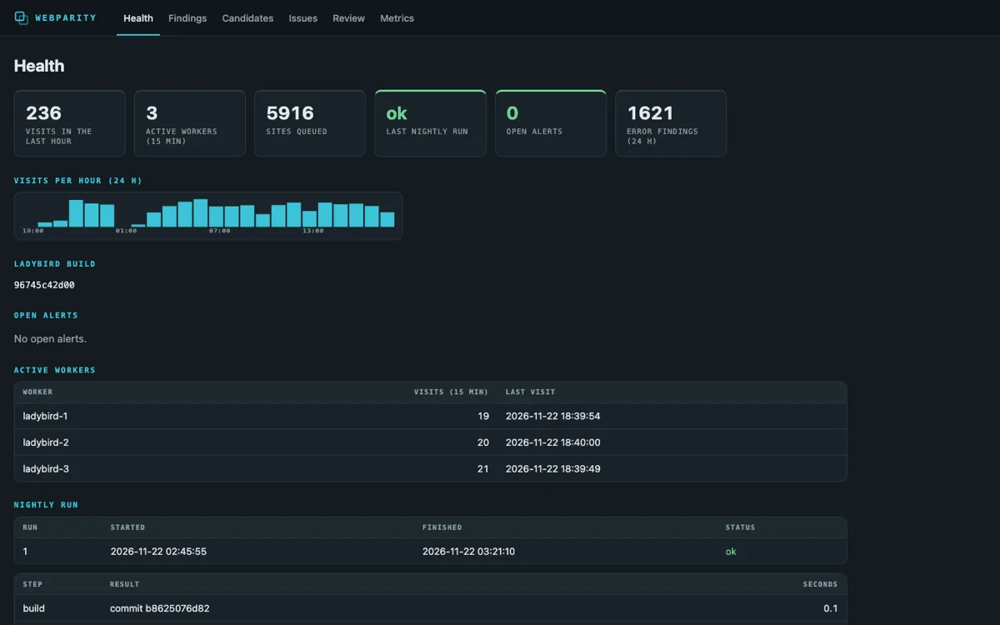

<!-- SPDX-License-Identifier: BSD-2-Clause -->
# webparity

webparity loads real websites in Ladybird and Chromium (and optionally Firefox) side by side, records every
difference, and helps turn the differences that hold up into reduced test cases and bug reports.

> **Status: in testing.** All parts of the plan are built and webparity runs alongside the explorer it replaces.
> Expect changes before the first release.

webparity is an independent project. It is not affiliated with or endorsed by the Ladybird Browser Initiative;
"Ladybird" is their trademark, used here to describe what webparity tests.

It is a rebuild, as a reusable Docker Compose stack, of the setup described in
[How I test Ladybird](https://gist.github.com/sco01/6ec1ca5e5edbef8622fdbbe7165dd410).



## Ground rules

These are built into the defaults and apply to anyone running webparity:

- Everything in the project is in English: code, comments, signatures, logs, documentation, CLI output and the web
  interface.
- No faked user agent and no bypassing of bot protection.
- Requests are rate limited per site. Reductions run against a local recording, not against the site.
- Nothing goes into a report that wasn't measured. A guess is labelled as a guess.
- Every issue is reviewed and filed by a person. webparity never posts on GitHub, and it never writes patches or opens
  pull requests against the engines it tests. The Ladybird team doesn't want automated issues or pull requests.

## What it does

1. **Visits** queued sites in Ladybird and Chromium at the same time, through a recording proxy: load, measure,
   screenshots, scroll, wheel, mobile view, menu, reload. Everything goes into a visit bundle.
2. **Detects** differences with detectors that only read the bundle: crashes, script errors, layout, images, fonts,
   scrolling, CSS, network, performance, missing features. Known differences are marked, not reported.
3. **Tracks** each error signature as a candidate, across sites, until it is investigated, filed, fixed or gone.
4. **Helps reduce** a finding offline from the recording to a small test case (`webparity reduce`).
5. **Follows issues** from draft to verification against new builds, reading GitHub anonymously.
6. **Monitors** itself: a web page with health, findings and candidates, Prometheus metrics, and alerts.

## Quick start

```sh
mkdir -p data && cp config.example.yaml data/config.yaml
LADYBIRD_BUILD=/path/to/ladybird/Build/release docker compose up -d --build
docker compose run --rm worker sites add https://example.org/
```

Then open <http://127.0.0.1:8700>. See [docs/getting-started.md](docs/getting-started.md).

## Commands

| Command | What it does |
| --- | --- |
| `webparity visit URL` | visit sites now and print the findings |
| `webparity probe FILE_OR_URL -j EXPR` | run a script or test case in all browsers (`--record`/`--replay` through the proxy) |
| `webparity replay VISIT` | replay a recorded visit offline and compare the DOM |
| `webparity reanalyze` | run the detectors again on saved bundles and show findings gone and new |
| `webparity reduce SOURCE -o OUT` | reduce a page to a small test case (ddmin over scripts, CSS, DOM, attributes, text) |
| `webparity worker` | visit queued sites until stopped |
| `webparity nightly` | canary, regression watch, verification, GitHub watch, retirement, requeue, INDEX.md |
| `webparity canary` | check that every detector fires on its canary page |
| `webparity sites`, `candidates` | the queue and the candidate list |
| `webparity draft`, `register`, `watch`, `verify`, `index` | the issue workflow |
| `webparity web`, `alerts` | the monitoring page and the alert loop |

## Documentation

- [Getting started](docs/getting-started.md) and [architecture](docs/architecture.md)
- [Detectors](docs/detectors.md) and [measurements](docs/measurements.md)
- [Reduction](docs/reduction.md), [issues](docs/issues.md), [monitoring](docs/monitoring.md)
- [Security review](docs/security.md), [how the agent works](docs/agent.md)
- [Licenses](LICENSES.md) and [third-party notices](THIRD_PARTY_NOTICES.md)

## Development

```sh
python3 -m venv .venv
.venv/bin/pip install -e ".[dev]"
.venv/bin/ruff check . && .venv/bin/ruff format --check .
.venv/bin/python tools/check_spdx.py
.venv/bin/pytest
```

Every false finding becomes a negative fixture in `tests/fixtures/detectors/` before the detector is fixed, and a
detector change is checked with `webparity reanalyze` against saved bundles before it goes live.

## License

BSD-2-Clause, see [LICENSE](LICENSE), [LICENSES.md](LICENSES.md) and [THIRD_PARTY_NOTICES.md](THIRD_PARTY_NOTICES.md).
